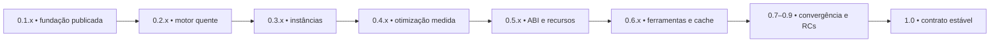

# Arandu — Roadmap mestre

**Revisão:** 2026-10-18. **Base publicada:** 0.1.10.
**Próximo marco de produto:** 0.2.0 — compilador quente e imagem dev recuperável.

Esta é a única fila permanente do projeto. Contratos descrevem comportamento
implementado; RFCs descrevem propostas e seus recortes; relatórios de release
preservam evidência de uma versão. O sufixo `v0.1` no nome deste arquivo é
histórico: seu conteúdo acompanha todas as versões do projeto.

## Como ler estados e versões

Há três dimensões independentes:

| Dimensão | Valores e significado |
| --- | --- |
| Maturidade | `gold`: escopo delimitado, publicado e exercitado pelo gate correspondente, sem bloqueador conhecido nesse escopo; `done`: implementação existente com obrigação de produto/prova pendente; `partial`: parte útil existe; `experimental`: disponível sem promessa de suporte completo; `planned`: ainda sem implementação do recorte |
| Governança | `Draft`/`Planned`: proposta ou investigação; `Accepted`: decisão aprovada; `Implemented`: recorte declarado implementado; `Frozen-R0`: baseline congelada; `Superseded`/`Rejected`: encerrada como proposta |
| Publicação | preparada, candidata, publicada ou reprovada; a tag e o gate de fonte não substituem instalação do arquivo público |

Uma RFC `Draft` pode ter partes implementadas: isso não aprova suas partes
restantes. `Implemented` vale para o recorte explicitado, não para toda expansão
mencionada em “futuro”. `in progress`, `[→]` e `[/]` de registros antigos são
substituídos aqui por `partial` acompanhado da lacuna concreta.

`0.N.0` identifica a entrada de um marco de produto; `0.N.x` comporta correções,
consolidação e incrementos compatíveis com seu contrato. As etapas abaixo
ordenam dependências, não reservam um número de patch para cada tarefa. Uma
correção urgente na 0.1.x não exige aguardar a 0.2, nem exige lançar 0.1.11
apenas para iniciar a próxima campanha. Não há datas prometidas: os gates
controlam a promoção. A partir da 0.4, a alocação por série é planejamento
revisável; propostas dependem de aceitação e evidência antes de virar escopo.

## Base entregue e evidência

| Área / IDs históricos | Estado atual | Escopo entregue e limites |
| --- | --- | --- |
| Frontend: lexer, parser, resolve, tipos, TYP.3.1/.2 | `done` | CST Rowan canônico → AST → resolução → tipagem bidirecional; inteiros padrão fixos de 32 bits e `isize`/`usize` por alvo (RFC 0023); APIs internas não são ABI pública |
| HIR/AMIR: INF2.1, F1, A5, A9, M1/M2 | `done` | pools/IDs, statements densos, CFG/SSA, definite-init e ownership por worklist; promoções de backing agregado têm exclusões próprias |
| Incrementalidade: A1, A10, PERF.5 | `done` | Salsa em `arandu_query`, queries por item, cutoff de exports, IDs de arquivo monotônicos, `DocumentId` geracional e revisão de snapshots; CLI batch recria a DB |
| A6/A7/A11 | `done` no recorte atual | lexer/categorização e caminhos SIMD existentes, tokens/internamento; nenhuma promessa geral de parsing branchless ou ganho em todo alvo |
| A8 / execução concorrente | `partial` | workers LSP limitados, cancelamento/prioridade e paralelismo existente; scheduler universal de compilação lock-free/NUMA/affinity não é garantia atual |
| BC, C_FB, Wasm | `done` nos contratos atuais | JIT/AOT Cranelift, emissor C e core-Wasm; LLVM, eBPF e SPIR-V não estão implementados |
| O0/O1/O2 | `done` / `done` / `experimental` | O1: SCCP, DCE e SimplifyCFG; O2 contém passes restritos, não SROA irrestrito nem promessa de spills/registradores |
| Memória: F2, G2, BC.1a, BV.1–3, AUD.0–5 | `done` nos recortes publicados | borrows, contratos de retorno, carriers/views, drops de strings e fallback GenRef; não equivale a provar todos os retornos/agregados/FFI |
| GenRef R0 | `Frozen-R0` | host/thread-confined, contratos e medição preservados; concorrência de handles/FFI/persistência não entram implicitamente |
| A4 / layout | `done` no recorte | LayoutEngine por alvo, classificação ABI e nichos admitidos; `@Repr("C")` tem política própria, raw ptr/GenRef não recebem nicho por suposição; SOO/tagging/reordenação universais não são garantias |
| CATCH / UNSAFE / ASYNC | `done` no recorte | catch e blocos unsafe já baixam para AMIR; async/await usa corrotina e limites A3/SL_R, ao contrário de lambdas ainda rejeitadas |
| A2 / A3 | `partial` / `done` no recorte | flags/anotações e observação de efeitos existem, capabilities/inferência completa têm contrato próprio; modelo async do compilador não equivale a runtime multiplataforma completo |
| Projeto/pacotes, T2/T3, visibilidade | `gold` no escopo publicado | `arandu.toml`, lockfile, dependências fixadas por digest/commit, new/init/tree/audit/vendor/verify/update, módulos e visibilidade; registry/build scripts/mixed targets não são garantias atuais |
| SYN.4.1/.2, SYN.5, TYP.4 | `done` no recorte | patterns qualificados/compostos, membros contextuais e const generics de `StaticMatrix`; formas mais amplas precisam de contrato próprio |
| DX / L0–L3 / IDE | `done` com evidência publicada | diagnósticos estruturados, UTF-16, cancelamento, apresentação compartilhada e VSIX instalado; budgets/endurance permanecem verificações recorrentes |
| PERF | `done` no recorte dev/debug | timers, tracing/self-profile e explain-rebuild; não prova automaticamente RSS, perf counters nem latência do produto |
| SL_T | `done` | harness e matriz nativa existentes; promoção `gold` exige o soak documentado, sem inferi-lo de uma execução verde |
| SL_P | `done` no recorte | worker pool bounded, redução e `AccumulatorInit` não-Copy; benchmark versionado existe; promoção depende de evidência específica de plataforma e transporte/drop |
| SL_R | `partial` | executor cooperativo, wakers, timers e reactor Linux epoll/io_uring; slots i64, hosts C e registro de sockets Win/macOS têm limites explícitos |
| SL_S-Core / SL_S-Host | `partial` | core, alloc, I/O em memória, FS por caminhos e processos; allocator/OOM/drop, targets freestanding e capabilities não estão integralmente fechados |
| CTFE CT.0–5 | `partial` na RFC ampla | núcleo público integrado; VM/superfície admitidas `done`; ver matriz específica abaixo |
| DIST.1/.2/.4 | `done`, publicados na 0.1.10 | empacotador TAR/ZIP, assets/checksums e CLI archive validate nativos; DIST.3 ainda parcial |
| E2 / ciclo de pacotes E4 | `done` no recorte | `arandu doc` HTML/JSON/Markdown e comandos de projeto/dependências; não há promessa de `arandu pkg`/registry |
| RFC 0022 / RFC 0027 | `done` nos recortes | AranduSmith e matriz diferencial; `--size`/`-Oz`, alcance e runtime sob demanda; framework completo de remarks continua proposto |

### Releases e campanhas encerradas

| Marco | Evidência e limite |
| --- | --- |
| S0–S3, decomposição, PascalCase, minimal/project lifecycle | decisões integradas; contratos técnicos preservam escopo, evidência histórica e resíduos; não são campanhas a reabrir integralmente |
| 0.1.7 / 0.1.8 | releases anteriores registradas no Git e em [releases/](releases/); não transferir prova de uma versão para outra |
| 0.1.9 | CTFE e redução de código integrados; distribuição Windows reprovada com LNK1181; tag imutável, [relatório](releases/0.1.9.md) preservado |
| 0.1.10 | publicada em 2026-10-15, commit `7df12f7a36ed872ea6c04287cb4e536525bc5291`; [Release 38779239029](https://github.com/arandu-lang/arandu/actions/runs/38779239029) verde, SDK/VSIX e archives públicos testados em Linux x86-64, Windows x86-64 e macOS ARM64; [relatório](releases/0.1.10.md) |

O smoke instalado da 0.1.10 inclui CTFE: check/run/build, execução nativa,
reutilização incremental e limite de fuel. Isso fecha essa prova específica;
não promove toda a RFC 0013, O2, async ou paralelismo a suporte irrestrito.
Falhas locais posteriores devem ser diagnosticadas sem apagar a evidência da
release. A auditoria local de 2026-10-15 observou variabilidade do gate LSP
`stdio_cold_initialize_p95_stays_within_budget`: 368/360 ms em falhas e 2,86 ms
em repetição aprovada; não há causa isolada nem gate global verde nessa rodada.

### Alterações locais e evidência de validação

A base publicada acima continua sendo a 0.1.10. Em 2026-10-16, o worktree
contém alterações ainda não publicadas para métodos inerentes de primitivos,
resolução de módulos implícitos, completion e stdlib. Presença de código/testes
não comprova integração ou suporte publicado. A auditoria documental preserva
essas alterações e não as classifica como entregues na 0.1.10.

A sequência obrigatória e os checks extras da consolidação documental anterior
passaram, incluindo `cargo test --workspace --locked` com quatro threads de
teste. Esses resultados pertencem àquela execução; alterações posteriores no
código exigem uma nova validação. A tentativa seguinte de 2026-10-16 aprovou
check/rustdoc/diag-docs, mas encontrou falhas de formatação/Clippy nas alterações
Rust e teve `cargo test` encerrado por SIGKILL durante compilação. O código
mudou durante essa tentativa, portanto ela não valida um snapshot estável.
A variabilidade histórica de initialize continua registrada para investigação,
mesmo após uma rodada completa verde anterior.

## Fila de execução

Ordem imediata para a próxima campanha, mantendo correções independentes na
0.1.x quando necessário:

| Prioridade / ID | Trabalho aberto | Dono e prova de saída |
| --- | --- | --- |
| P0 / DIST.3 | correção local implementada: SHA-256 obrigatório, OpenSSL/fallback, archive/BLAKE3 em staging e rollback | 22 testes herméticos passaram com pytest/Ruff; CI; falta promoção com pacote nativo exato |
| P0 / GATE.LSP | corrigido risco local de deadlock: soltar snapshots antes de backpressure e descartar jobs cancelados antes de writes; investigar variabilidade histórica sem aumentar orçamento | regressões determinísticas e 67 unitários passaram; stdio e gate final ainda exigidos no mesmo snapshot |
| P0 / NUM.C | guards locais para div/mod C e alinhamento de shifts/narrow nos três backends | corpus de resultado/trap em O0/O1/O2/Os e Wasm executado; revalidar no snapshot final com nextest |
| P0 / WASM.CFG | corrigidos escopos de salto cruzados, cópias de argumentos na aresta errada e desreferência parcial de agregados | Decimal/hashes em Wasmtime e projeções em C/Cranelift/Wasm passaram; regressão estrutural cobre diamantes, backedges e self-loops; gates finais pendentes |
| WIP / PRIMITIVES | métodos inerentes/descoberta/completion de primitivos aparecem em alterações locais, fora da base publicada | parser/resolve/query/typeck/IDE/stdlib; provas de cutoff, colisões/identidade, diagnósticos e gates completos antes de atribuir uma release |
| P1 / HOT.1 | baseline representativo e medição repetida de latência, CPU/RSS, hits e invalidação | xtask/benchmarks; p50/p95 e comparação clean/batch/quente com host/corpus/configuração documentados |
| P1 / HOT.2–6 | sessão reutilizável, protocolo/supervisor, imagem dev, recuperação e endurance | CLI/query/codegen; gates 0.2 abaixo, sem I/O nas queries |
| P1 / AGG.1 | reproduzir e classificar gaps de lifetime/cleanup dos fallbacks admitidos; correção local de GenArena.get com Copy e novo getRef para impedir duplicação de owners | MIR/backends; resultados corretos, alloc/free e RSS limitado; bug de memória reproduzido bloqueia release |
| P2 / CT.4–5 e IDE | campanha de editor/playground e ampliação do corpus real | query/IDE/web/extensão; prova correspondente, sem equiparar smoke instalado ao universo de alvos |
| P2 / SL_T, SL_P | fechar soak e evidência nativa específica antes de promover `gold` | harness/runtime; artefatos versionados por campanha e matriz descrita nos contratos |

## Campanha autorizada 0.1.11 — fechamento da stdlib

Em 16/10/2026 o escopo foi ampliado explicitamente pelo mantenedor: fechar
as alterações locais e os bloqueadores, e implementar a fundação abaixo antes
da 0.2.0. A tabela registra entregas autorizadas, não funcionalidades publicadas.
A 0.1.11 permanece em desenvolvimento enquanto houver itens não concluídos;
a extensão do escopo não reduz as provas nem promove suporte por inferência.
Como evidência histórica, o snapshot de 17/10 passou nos gates ordenados, em 3.184 testes nextest
(sete ignorados), doctests, determinismo e checks documentais/arquiteturais.
O C SIMD passou também em ASan/UBSan; os checks Rust de Windows/macOS usaram
`blake3/pure`. Instalador e Extension Host mantêm a evidência histórica de 16/10. A [arquitetura da stdlib](arandu-stdlib-architecture-v0.1.md#evidência-local-desta-revisão)
registra o alcance dessa prova. A revisão de 18/10 usa validação direcionada por
camada, conforme AGENTS.md; a prova global anterior não certifica automaticamente
as mudanças posteriores. A matriz instalada da candidata ainda é pendente.

| ID | Entrega | Estado / critério de saída |
| --- | --- | --- |
| ST.0 | consolidar primitivos, Decimal e alterações locais | `in_progress`; Decimal com overflow checado, comparação exata, HalfEven e conversões validadas no corpus contratual e no oráculo inteiro independente executados nos três backends (C/Cranelift/Wasm); gates locais passaram; manter as provas de métodos/imports/completion e cutoff no SDK instalado |
| ST.1 | `core.math`: sqrt, sin/cos/tan, pow, log/exp e PI/TAU/E | implementação escalar local; corrigidos trunc acima de 32 bits, round, escala extrema de exp, potências subnormais e overflow intermediário de cbrt; regressões independentes IEEE/f64 nos três backends; oráculos trigonométricos (sin, cos, tan) e logarítmicos (ln) com tolerâncias ULP e bordas fechados e validados em JIT, C (Clang -O0/-O2 UBSan) e Wasm; perfis float32 e matriz instalada pendentes |
| ST.2 | `core.simd`: seis vetores de 128 bits | implementação local de tipos canônicos, métodos/intrínsecos tipados, layout 16/16, AMIR e Cranelift/C/Wasm; máscaras/comparações/select, wrapping e slices com bounds; escrita segura usa MutableSlice afim, descritores compartilhados exigem unsafe; backing heap do compilador alinhado a 16; CTFE concluído e verificado na VM com suporte a 128-bit hardware vectors, splat, extract/insert, ops, select, shuffle e intrínseco abort; faltam provas do SDK instalado na matriz nativa por alvo (RFC 0038) |
| ST.3 | Q8.8/Q32.32 e correção de Q16.16 | implementação local; oráculo i128, JIT/C com UBSan/Wasm; 384 pares inteiros e gates locais passaram; conversões float validadas com clamping e oráculo diferencial nos três backends; matriz instalada pendente |
| ST.4 | contagem/reversão de bits em `core.num` | implementação local u32/u64 nos três backends e avaliação puramente escalar no CTFE (popcnt, clz, ctz, bitrev); zero definido; identidade ABI explícita e validação de assinatura antes do codegen; integração local e testes de CTFE validados; matriz instalada pendente |
| ST.5 | atomics reais como pré-requisito de compartilhamento | implementação local SeqCst em C/Cranelift/Wasm com assinaturas e armazenamento validados; primitivas de sincronização e Arc têm bounds canônicos específicos, sem liberar ponteiros arbitrários; wrappers atômicos comuns ainda exigem mut ref para escrita; fechar matriz instalada |
| ST.6 | `alloc.boxed.Box<T>` | implementação local nativa e Wasm; Cranelift/JIT e C O0/O2 executam drops aninhados/ZST, movimento e mutação; rejeição de escapes/aliases/forja passou; o teste Wasm emite o módulo e valida que é core, mas não o executa em Wasmtime; faltam execução do contrato Box em Wasmtime, injeção de falha de alocação e prova específica pelo SDK instalado |
| ST.7 | `alloc.rc`/`alloc.arc` | implementações locais; Rc.tryUnwrap impede ressurreição por Weak; Arc usa CAS com limites antes de overflow e trava da contagem fraca para unicidade/getMut; Arc/ArcWeak exigem T:Send+Sync para transporte/compartilhamento; o código limita Rc antes de overflow, mas a regressão white-box de overflow encontrada cobre Arc, não Rc; faltam regressões de overflow Rc e falhas de alocação, além de prova específica pelo SDK instalado |
| ST.8 | `alloc.slab` e deque circular | Slab/deque executados no contrato CLI em JIT e C O0/O2 UBSan; o corpus cobre reuso de slot do Slab, crescimento/wrapping e elementos `String` do deque; Wasm só é emitido nesse teste. Corrigido overflow de capacidade do deque: arredondamento/crescimento abortam antes de ultrapassar o limite de alocação, com regressão para `usize::MAX`; ainda faltam execução do contrato em Wasm e regressão de drops não-Copy observáveis do deque |
| ST.9 | `std.random` | correções locais: fórmula xoshiro256++/seed zero, faixa int completa, entropia sem fallback fraco e tryFromEntropy falível; 136 vetores determinísticos em JIT/C/Wasm e injeção de falha C passaram; PRNG determinístico Wasm executa sem imports de host (poda aplicada também ao perfil padrão); entropia continua efeito de host; faixas float (`genRangeFloat` e `nextFloat`) validadas em JIT/C/Wasm; fechar execução por alvo; PRNG não é CSPRNG |
| ST.10 | `sync.mutex`/`sync.rwlock`/`sync.condvar` nativos | implementação local com mutabilidade interior canônica, guardas afins ligadas ao proprietário, leitores compartilhados e escritores FIFO por fases; Condvar libera/reobtém MutexGuard, timeout monotônico e notify sem wrap da sequência; sem polling; cancelamento POSIX diferido no mirror C; integração cooperativa do executor e matriz nativa instalada continuam distintas (RFC 0039) |
| ST.11 | `std.thread` e JoinHandle/parking | implementação local de IDs/park/unpark e spawn<A,R,J> por ThreadJob tipado; a branch atual também baixa `move || ...` sem parâmetros e com capturas próprias Send para struct de captura e `run()` no AMIR; isso ainda não promove suporte público e depende do fechamento da candidata; closures sem move ou com parâmetros continuam U001; referências continuam T025; argumentos/jobs/resultados Send, buffers alinhados, join e drop que aguardam/limpam exatamente uma vez; retenção JIT inclui descendentes e join/drop concorrentes; parkTimeout interrompido por unpark com prazos monotônicos, tokens coalescentes e saturação de limites em C/Rust; rejeição em tempo de compilação em wasm32 (U001) e, em alvo bare-metal, T099 para `std.thread`/`std.fs`; closures gerais da RFC 0032 e unwind recuperável permanecem fora do contrato; fechar matriz nativa instalada |
| ST.12 | filesystem por capacidades `Dir` (RFC 0016) | implementação Linux local com openat2 BENEATH/NO_SYMLINKS/NO_MAGICLINKS e pais pinados em mkdir/unlink; regressões JIT/C com UBSan e runtime passaram para caminhos absolutos, traversal, symlinks e rename da raiz; sem fallback inseguro; macOS/BSD têm recorte de um componente com O_NOFOLLOW/O_DIRECTORY/fstat em Rust/C; flags create/truncate sem write rejeitadas; Windows fail-closed até ABI de HANDLE; `File.fd` é privado, `close` invalida e o destructor evita double close. Permanecem sem prova de pacote instalado os contratos específicos de filesystem por alvo. |
| ST.13 | DNS/UDP e reactor multiplataforma | DNS/UDP e lifecycle de sockets têm testes locais; o reactor só registra sockets no Linux e retorna erro nos demais alvos; IOCP/kqueue não estão implementados. Tratar esse suporte como ausente, não apenas sem teste; definir explicitamente o contrato de alvos da 0.1.11 antes de promover |
| ST.14 | `crypto.hash` SHA-256/BLAKE3 | implementação escalar local; vetores independentes de streaming/padding/chunks/árvore e snapshots passaram em C/Cranelift/Wasm; sem autenticação/keyed/XOF; matriz instalada e promoção pendentes |
| ST.15 | `math.big.BigInt`/`BigDecimal` (RFC 0037) | `done` localmente; camadas 1–3 ativas com adições de `divRem`, `div`, `rem`, `divAssign`, `remAssign`, `BigDecimal.mul`, operações de bit e representação de limbs; oráculo diferencial independente contra `num-bigint` (dev-dependency) com 59 casos curados cobrindo além de 128/256/512 bits executado e validado em JIT (Cranelift) e C (Clang -O0 e -O2 com UBSan). No teste CLI consultado, Wasm apenas é emitido e validado como core module; não há execução do oráculo BigInt/BigDecimal em Wasmtime comprovada. |
| ST.16 | promoção da candidata | `partial`; o CI do commit `d99c9e41` construiu, instalou fora do checkout e testou o SDK candidato em Linux x86-64, macOS ARM64 e Windows x86-64; integração SL_T passou nos três alvos. Isso não equivale a publicar/instalar os archives da release nem cobre automaticamente cada contrato ST. Os gates do head documental `5ec5479c` estavam em execução quando esta nota foi escrita; a promoção ainda exige merge, tag, workflow de release e fechamento das provas específicas restantes. |

A ordem de execução é: bloqueadores e ST.0 → aritmética/ST.3/ST.4 →
fundação de memória e atomics → coleções/precisão arbitrária → serviços e
concorrência → SIMD/math e integração final conforme dependências. Frentes
independentes podem avançar em paralelo. ST.11 inclui fixar e implementar o
entrypoint de thread e o transporte possuído de capturas/retornos. Qualquer
recorte de chamadas/capturas necessário à API autorizada deve ser antecipado
para essa campanha; LAMBDA na 0.3.x descreve a expansão geral posterior, sem
adiar um pré-requisito da mesma API de threads. Os contratos técnicos mantêm
design e limitações; esta é a única fila permanente.

### Etapas de fechamento das RFCs 0014, 0016, 0038 e 0039

As etapas abaixo detalham ST.2/ST.10–12; continuam pertencendo à campanha
0.1.11 e não são transferidas automaticamente para 0.2.x por estarem abertas.

| Etapa | Estado | Próxima entrega verificável / proprietário |
| --- | --- | --- |
| ST.2a — representação e execução interna | implementada localmente | seis formas, layout e AMIR; JIT/C/Wasm, wrapping, memória, shuffle, ABI interna e hashes; middle/MIR/backends |
| ST.2b — identidade e frontend | implementada localmente | autoridade stdlib explícita por arquivo, aliases/reexports por SymbolId, assinaturas exatas e métodos genéricos sem reconhecimento por nome solto; preservar cutoff e validar drivers/SDK |
| ST.2c — API fonte e memória | implementada localmente | API nativa, índices checados, backing 16-aligned, loads escalares e stores com MutableSlice exclusiva; garantir a mesma prova nos artefatos instalados e alvos de 32 bits |
| ST.2d — máscaras e portabilidade | parcial | comparações/select/reduções e contrato NaN/zero implementados; executar matriz instalada/ARM e medir workloads antes de anunciar desempenho |
| ST.10a — evento de sequência | implementada localmente | filas por endereço, validação/timeout/notify e isolamento de tokens; runtime Rust/C, JIT e host Wasm explícito |
| ST.10b — locks compartilhados seguros | implementada localmente | UnsafeCell não-Copy/não-Sync, Mutex/RwLock com bounds distintos e guardas que conservam empréstimos até dentro do mesmo bloco; validar SDK instalado |
| ST.10c — Condvar com guarda e PFLock | implementada localmente | release/sequence-wait/reacquire, fases por filas reais e contadores checados, cancelamento POSIX diferido; sem garantia de quatro bytes ou prazo de parede; promover somente após matriz nativa |
| ST.11a — identidade e estacionamento | implementada localmente | IDs sem reuso, park/unpark e aposentadoria TLS/FLS; parkTimeout com prazo monotônico e interrupção por unpark validado em C/Rust; wasm32 rejeita primitivas de threads com U001; validar matriz nativa instalada |
| ST.11b — spawn e JoinHandle | implementada localmente; promoção pendente | ThreadJob tipado e possuído transporta argumentos/capturas e resultados Send; a branch atual baixa o recorte `move || ...` (zero parâmetros, capturas próprias Send) para struct de captura e `run()`; validar cleanup/drop, retenção JIT e packages nativos; closures gerais/unwind continuam fora do contrato |
| ST.12a — confinamento Linux | implementada localmente | openat2 e pais pinados, flags destrutivas rejeitadas e provas de symlink/traversal/rename |
| ST.12b — macOS/BSD e Windows | parcial / pendente | componente único por Dir em macOS/BSD exige runners nativos; Windows exige ponte HANDLE/posse sem truncamento, NtCreateFile relativo e rejeição de ADS/dispositivos; falhar fechado até lá |
| ST.12c — adoção de capacidades | implementada localmente | privacidade/lifecycle integral de File (`File.fd` é `private` com construtor interno `File.fromRaw`), migração das aberturas legadas e regressões de capacidade com drop seguro; garantir testes na matriz instalada |
| RFC 0014 — poda de imports | implementada localmente | mesma closure nos perfis padrão/size/component, incluindo WIT; efeitos vivos exigem host, indiretas gerais continuam fora do lowering atual |

## Plano de longo prazo por série

As séries organizam o trabalho; não são promessa de entrega de toda RFC
associada. Cada candidata declara seu recorte e limitações antes da promoção.

| Série | Resultado principal | Dependências / gate | Estado |
| --- | --- | --- | --- |
| 0.1.x / 0.1.11 | fundação publicada e fechamento autorizado da stdlib | bloqueadores, ST.0–16, regressões e distribuição do pacote exato | 0.1.10 publicada; 0.1.11 em desenvolvimento |
| 0.2.x | motor quente e imagem dev recuperável | sessão Salsa viva, protocolo/fallback, equivalência clean e p95 ≤100 ms em edição de corpo no host/corpus de referência | `planned`; fundação batch `done` |
| 0.3.x | granularidade por instância e expressividade delimitada | completar produtores/CGUs, retenção e cutoff; p95 ≤10 ms no workload de referência; closures e reflexão inicial têm gates próprios | `partial` na granularidade; expansões `planned` |
| 0.4.x | qualidade de código de release mensurada | OPT/AOT oracle, segurança de alias/escape e benchmarks; LLVM opcional só após aceitação da RFC 0031, paridade e distribuição | `experimental` O2; backend novo `planned` |
| 0.5.x | contratos portáveis de ABI, recursos e interoperabilidade | layout/calling convention por alvo, ownership/FFI e runtime; capabilities/freestanding e WIT/mobile avançam por recortes | base `partial`; expansões `planned` |
| 0.6.x | ferramentas e armazenamento sustentáveis | CAS/GC/formatos compatíveis quando justificados; documentação/pacotes existentes evoluem, REPL/bindgen/linter por contrato | base `partial`; expansões `planned` |
| 0.7.x | convergência dos contratos candidatos à estabilidade | fechar inventário público, deprecações, ambiguidades de linguagem e incompatibilidades entre alvos suportados | `planned` |
| 0.8.x | endurance e distribuição de candidata a 1.0 | soak, fuzz/sanitizers, consumo prolongado, upgrades e recuperação com SDK público | `planned` |
| 0.9.x | congelamento de contrato e RCs de 1.0 | migração publicada, corpus de consumidores, nenhuma falha bloqueante nos gates definidos | `planned` |
| 1.0 | linguagem/stdlib/CLI e matriz de suporte explicitamente estáveis | política de compatibilidade, documentação, diagnóstico e distribuição consistentes; zero bloqueadores conhecidos no escopo | `planned` |
| 1.x | manutenção e evolução compatível do contrato estável | correções e adições preservam compatibilidade documentada, migração/avisos para deprecações e gates de consumidores; novos backends não ampliam suporte por inferência | direção de governança, sem calendário |
| 2.0 ou novo contrato incompatível | mudanças incompatíveis somente quando justificadas | RFC aceita, alternativa/migração explícita, coexistência quando necessária e evidência de consumidores; não é destino automático de uma proposta atual | sem escopo de funcionalidades definido |
| pós-1.0 / trilhas independentes | auto-hospedagem e extensões de domínio | projeto, mantenedores, contratos e provas próprios; não bloqueiam 1.0 por existir uma RFC | pesquisa/proposta |

A sequência representa gates principais; correções e trilhas independentes
podem avançar em paralelo sem promover propostas automaticamente.

### 0.2.x — Motor quente e imagem dev

A 0.2.0 exige HOT.1–6 e o fechamento da campanha de stdlib ST.0–16
autorizada acima. Patches seguintes ampliam o corpus e cobertura e
corrigem problemas mantendo o contrato. O `p95` é ponta a ponta até o artefato
publicado; amostras, aquecimento, perfil e exclusões precisam ser explícitos.

| Etapa | Entrega | Aceitação |
| --- | --- | --- |
| HOT.1 — medir antes | expandir `xtask bench-incremental`; corpus pequeno/médio/representativo, edições repetidas e descrição de host/filesystem/toolchain | p50/p95, CPU/RSS, queries, CGUs e fases; o harness mínimo atual prova determinismo, não o gate de latência |
| HOT.2 — sessão | extrair configuração/inputs/análise/codegen/publicação da execução batch e preservar DB entre builds | corpo privado não invalida exports/CGUs irmãs sem necessidade; trocar target/opções/stdlib/toolchain invalida o estado correto |
| HOT.3 — serviço local | protocolo versionado, endpoint com ownership local, supervisor, isolamento por workspace/configuração, fila limitada/coalescida, prioridade e cancelamento | clientes concorrentes e falhas não causam deadlock, starvation nem resultado stale; nenhuma serialização da DB Salsa |
| HOT.4 — publicação | imagem dev recuperável com ranges/páginas ou CoW quando disponível; artefato publicado/CAS imutável | staging e publicação atômicos; ausência de suporte usa fallback; hardlink não autoriza mutação de objeto compartilhado |
| HOT.5 — recuperação | kill durante análise/codegen/publicação, cache corrompido/incompatível e reinício | fallback transparente ao CLI batch e equivalência byte a byte com clean; não aceitar estado não verificado |
| HOT.6 — promoção | workloads prolongados, repetição de edições e matriz nativa instalada | RSS/filas limitados e p95 ≤100 ms para corpo no host de referência; CI compartilhada registra tempos sem impor esse limite |

Não são gates automáticos da 0.2: todo CAS global, hidratação binária da IR,
LLVM como backend promovido, metaprogramação ampla, todas as otimizações de LUT,
ABI pública geral ou self-hosting. Bugs de correção e falhas de integridade
continuam bloqueantes.

O código de interoperabilidade freestanding foi iniciado nesta branch com o
backend LLVM, sem substituir HOT.1–6 nem promover suporte público. As triples
canônicas são
`thumbv6m-none-eabi`, `thumbv7em-none-eabihf` e
`riscv32imc-unknown-none-elf`. O produto padrão é
objeto, IR (`--emit=llvm-ir`) ou `--crate-type=staticlib`. Um ELF final existe
somente quando o usuário passa `--linker-script`. O compilador não adivinha
mapas de memória do chip. `core` permanece freestanding; `std.thread` e
`std.fs` em alvo bare-metal produzem T099. O recorte `move ||` sem parâmetros
e com capturas próprias Send baixa para uma struct de captura e `run()`;
closures gerais continuam U001.

A aceitação desses produtos na 0.1.11 depende de CI e de uma decisão explícita
de promoção; até lá, permanecem experimentais nesta branch. A remoção de
aliases legados de anotações só pode entrar na fronteira 0.2.0 com decisão
explícita, release notes e regressões de migração; não é requisito para
promover o serviço quente.

### 0.3.x — Instâncias, closures e staging delimitado

| ID | Base atual | Trabalho / gate |
| --- | --- | --- |
| INC.3 | `function_hir`, `instance_hir`, `runtime_raw_unit`, `instance_contracts`, `runtime_unit`, compositor e closure CGU ativos | completar entrega/metadata/retention; editar corpo privado não rebaixa importadores ou CGUs irmãs; clean/incremental idênticos e p95 ≤10 ms no host/workload declarado |
| LAMBDA / [RFC 0032](rfcs/0032-closures-ossa-capture-modes-and-first-class-functions.md) | parser/tipos preparam lambdas; closures gerais continuam U001; só `move ||` sem parâmetros e com capturas próprias Send baixa para ThreadJob | contrato de capturas, Copy/Move/borrow, representação ambiente, chamadas indiretas, drops/escape e paridade C/Cranelift/Wasm antes de habilitar o sistema geral |
| CT.NEXT | valores e layout existentes | refletir tipos/descritores imutáveis apenas após contrato aceito de identidade, visibilidade, efeitos e budgets; atributos executáveis/geração de itens não entram por consequência |
| TYP.NEXT / [RFC 0034](rfcs/0034-adaptive-hybrid-polymorphism-and-witness-tables.md) / [RFC 0036](rfcs/0036-typed-holes-and-integrated-semantic-tooling.md) | inferência contextual, interfaces estáticas e const generics existentes | separação `constraint_gen`/solver é melhoria arquitetural não bloqueante; tipos de literal tardios, typed holes e ergonomia só com escopo/recovery/determinismo; `dyn`/existenciais e dispatch adaptativo continuam propostas separadas |

A meta de instância não exige persistir Salsa. Formatos duráveis, se
necessários, serializam saídas canônicas versionadas fora do grafo, com
validação de compatibilidade e dependências explícitas.

### 0.4.x — Otimização e backend de release

Sequência: provas de place/alias/efeitos → análises reutilizáveis → passes
restritos medidos → oráculo de codegen → promoção do nível de otimização.
O1 permanece baseline; O2 não vira estável apenas porque `--release` o usa.

| IDs | Entrega planejada | Gate |
| --- | --- | --- |
| OPT.1–7 / [RFC 0033](rfcs/0033-amir-cooperative-optimization-place-provenance-and-memoryssa.md) | análises, loops, dataflow, canonicalização, memória, TCO/escape | sequência e regressões detalhadas adiante; sem ganho prometido por contagem de clones/linhas |
| AOT / RFC 0025 | remarks estruturados, runner de diretivas e fuzz metamórfico especializado | política por passe, replay/redutor e oráculo independente; AranduSmith existente não comprova essas ferramentas |
| LLVM / RFC 0031 | tier opt-in de produção, se a proposta for aceita | backend puro, layout por alvo, paridade/ABI, compile-time/RSS/tamanho/runtime medidos e empacotamento próprio; Cranelift continua disponível |
| GEN / REG / PGO ([RFC 0034](rfcs/0034-adaptive-hybrid-polymorphism-and-witness-tables.md)) | investigar monomorfização adaptativa e perfil guiado | workload primeiro; alocação física de registradores pertence ao backend; nenhum algoritmo ou zero-spill garantido pelo Arandu |
| C_PRETTY.1–4 | CFG estruturado, nomes/escopos, coalescência e headers C | paridade de efeitos/CFG, cobertura de fluxo irredutível e contrato de headers; legibilidade não equivale a certificação MISRA |

MLIR, Linalg/StableHLO e aceleradores não são requisito de um primeiro backend
LLVM. Metadados noalias dependem de prova de proveniência/alias e escopo de
validade; não marcar todas as operações de um bloco por existir um BorrowMut.

### 0.5.x — ABI, runtime e interoperabilidade

| IDs | Entrega planejada | Gate |
| --- | --- | --- |
| AGG.1–3 / ABI | lifetime dos fallbacks, retornos/views/agregados e calling conventions documentadas | phis em backedges, views cruzando branches, retorno Wasm, FFI e suspensão com ownership/drop; alloc/free/RSS e resultados nos três backends |
| SL_S-Core.1–4 | promoção freestanding delimitada, TrapCode e formatos fixos adicionais | núcleo sem host/heap implícito no alvo declarado; teste de objeto/opcode e tamanho; Q8.8/Q32.32 e intrínsecos de bits por recorte |
| A2 / effects / [RFC 0035](rfcs/0035-effect-system-polymorphism-and-capability-authority.md) | inferência/summaries e autoridade por contrato, separados da base de flags/anotações | [contrato de efeitos](arandu-effects-v0.1.md), propagação determinística, unknown conservador e enforcement independente |
| SL_S-Host.2–5 / RFC 0016 | Dir por capacidades, resolução segura, efeitos e VFS | testes adversariais de traversal/symlink/TOCTOU nos sistemas admitidos; canonicalização/ciclo não provam sandbox |
| SL_R / SL_P | hosts async e transporte de resultados, drop glue e matriz de paralelismo | sockets reactor Win/macOS e executor C conforme contrato; ownership de resultados não-Copy e benchmarks 1/2/4/8 workers |
| WIT / MOBILE / FFI | RFCs 0014/0015/0030 por recortes aceitos | layout/validação de buffers, lifetimes, erros explícitos, callbacks/threads e testes de consumidores; trap/abort fatal não é exceção recuperável no mesmo processo |

### 0.6.x — Ferramentas e cache

| IDs | Base atual | Próxima entrega / gate |
| --- | --- | --- |
| CACHE.1–4 / RFC 0019 | cache de pacotes por digest e cache CGU local com lock/GC | CAS global de compilação, target limpo e GC/LRU/cotas por contrato aceito, deduplicação e concorrência medidas |
| CACHE.5 | envelopes íntegros `.air/.amir/.ameta` com dumps textuais write-only | hidratação de IR só após schema/compatibilidade/IDs/invalidação, oráculo clean e benefício medido |
| E1 / REPL ([RFC 0036](rfcs/0036-typed-holes-and-integrated-semantic-tooling.md)) | JIT existente, sem REPL público | sessão, redefinição/estado/erros e saída de recursos documentados; nenhuma avaliação de programa inválido |
| E2 / DOC | `arandu doc` HTML/JSON/Markdown implementado | ampliar corpus/links/busca/acessibilidade conforme necessidade; não reimplementar gerador existente |
| E3 / bindgen ([RFC 0036](rfcs/0036-typed-holes-and-integrated-semantic-tooling.md)) | contratos ABI ainda restritos | headers/tipos suportados e roundtrip C com layout, ownership e erros explícitos |
| E4 / pacotes | lifecycle/lockfile/vendor/audit/verify implementados | registry/workspaces/mixed/build scripts só após contratos de identidade, integridade e trust; nome `pkg` não é objetivo por si só |
| E5 / linter ([RFC 0036](rfcs/0036-typed-holes-and-integrated-semantic-tooling.md)) | ownership/escape e diagnósticos existentes | lints opt-in com resultados reproduzíveis, poucos falsos positivos e replacements estruturados |

### 0.7.x a 1.0 — Convergência e estabilidade

0.7.x inventaria todas as APIs/comandos/alvos que serão estáveis, resolve
ambiguidades e anuncia deprecações; não deve abrir uma frente obrigatória por
cada RFC pendente. 0.8.x exercita consumidores e SDK público em longas sessões,
crash recovery, upgrades/rollback, fuzz e análise de recursos. 0.9.x congela o
escopo candidato, publica migração e usa novas RCs imutáveis para correções.

1.0 exige contrato explícito de compatibilidade de linguagem, stdlib, CLI,
manifest/lockfile, diagnósticos públicos e matriz suportada; documentação e
artefatos devem concordar. APIs Rust internas, HIR/AMIR e formato de cache não
se tornam estáveis por consequência. Desempenho tem budgets/workloads
publicados, sem promessas universais. Self-hosting, GPU, eBPF e stack científica
completa não bloqueiam esse contrato.

Depois de 1.0, a série 1.x mantém as promessas estáveis e publica a evolução
compatível. Uma quebra futura precisa de motivação, decisão e migração antes
de reservar uma fronteira incompatível; não se inventa hoje uma lista de
funcionalidades obrigatórias para 2.0.

## Núcleo CTFE integrado e evolução futura

| Gate | Maturidade atual | Pendência específica |
| --- | --- | --- |
| CT.0 — contrato/staging | `partial` na RFC; núcleo delimitado aprovado | definir/aceitar separadamente efeitos ampliados, reflexão e geração de código; não reabrir o núcleo implementado |
| CT.1 — alvo/layout | `done` no recorte de layout | validação `DataLayout`, LayoutEngine e identidade de alvo existem; ampliar bordas e distinguir layout conhecido de codegen suportado |
| CT.2 — VM pura | `done` no subconjunto admitido | CFG/chamadas/budgets/cancelamento, Copy/enums/arrays/strings e floats IEEE software; recursos runtime/closures não são admitidos |
| CT.3 — superfície | `done` no recorte público | raízes isoladas, retornos locais, seleção/iteração finita, globais, headers e argumentos calculados; expansão além do contrato requer desenho próprio |
| CT.4 — Salsa/editor | `partial` | `item_staged_typing`, raízes/cutoff, diagnósticos e editor conectados; falta campanha representativa de latência/recursos e paridade do playground |
| CT.5 — produto/release | `partial` com smoke nativo publicado | SDK 0.1.10 testou `comptime_core` nos três alvos; ampliar corpus real e validar playground/limitações, sem inferir aprovação da RFC inteira |

Contrato e regressões vivem em [comptime core](arandu-comptime-core-v0.1.md),
[ABI/layout](arandu-abi-layout-v0.1.md) e [RFC 0013](rfcs/0013-deterministic-ctfe-and-comptime-metaprogramming.md).
`mem.sizeOf<T>()`/`mem.alignOf<T>()` e `@sizeOf`/`@alignOf` são existentes;
`embed.bytes`, `embed.str`, `types.info<T>()`, quote/splicing e atributos
customizados permanecem propostas, não APIs liberadas por esta revisão.

### Agregados e workload real

AGG.1 comprova/corrige lifetime e cleanup; AGG.2 otimiza LUTs imutáveis e cópias
após provar proveniência/imutabilidade; AGG.3 amplia retornos/views/suspensão
conforme ABI. Bugs reproduzidos são P0 independentemente da série que concentra
a expansão. Otimizações sem bug não impedem desenvolver HOT em paralelo.

Cranelift promove casos admitidos com orçamento de frame de 1 KiB; Wasm usa
16 KiB e uma shadow stack separada de rodata/heap. Valores maiores admitidos
usam scratch privado lazy/reutilizável. Serialização estática já existe; não
prova referência direta universal à rodata ou zero malloc do scanner Pypor.
Phis agregados em backedges, views emprestadas, retenção externa e suspensão
continuam excluídos de promoções sem prova. Não inserir frees incondicionais.

As medições históricas do Pypor e de agregados estão no contrato ABI: comparar
alocações/liberações, pico de RSS, estabilidade em loops, resultado e assembly
antes/depois. Contagem de malloc do processo não mede apenas LUT nem prova leak.

## Trilha incremental nativa — RFC 0011

| Marco | Estado | Limite atual / saída |
| --- | --- | --- |
| Fundação 0.1 | `done` | fingerprints/closure e artefato verificados, cutoff de trivia, chaves CGU canônicas, sidecars, reuse sem link e patch ELF fail-closed Linux; CLI ainda cria DB nova |
| Motor quente 0.2 | `planned` | HOT.1–6; DB viva, protocolo e publicação recuperável; p95 ≤100 ms e equivalência clean |
| Instâncias 0.3 | `partial` | produtores/compositor e closure CGU ativos, regressões de instância nova e objetos clean; faltam gates completos de entrega, retenção, latência e matriz; p95 ≤10 ms delimitado |

CAS remoto/distribuído e persistência de IR são decisões posteriores ao perfil
do caminho quente; nenhuma delas autoriza serializar o grafo Salsa.

## Otimização AMIR — estado e sequência

O `PassManager` executa transformações puras por função, separado da
memoização Salsa. O0 não transforma; O1 itera SCCP → DCE mark-sweep →
SimplifyCFG. O2 é experimental: scalar replacement Copy e self-tail calls
restritos, field forwarding/GVN/SCCP/LICM/DCE/tail merging/SimplifyCFG.
Alcance compartilhado de funções/drop/runtime existe (RFC 0027); expansão
interprocedural e reflection futura precisam preservar raízes públicas e tooling.
SROA irrestrito, LoopInfo reutilizável/nesting e promoção geral por escape não
são garantias atuais. OPT.1–7 abaixo preservam a ordem técnica da trilha 0.4.x;
alguns recortes já existem, e a promoção depende do contrato completo.

### OPT.1–7 — Sequência executiva

O desenho técnico foi consolidado na [RFC 0033](rfcs/0033-amir-cooperative-optimization-place-provenance-and-memoryssa.md),
ainda `Draft`. Esta tabela mantém estado, dependências e prova de saída; os
nomes de APIs propostos na RFC não representam código implementado.

| Etapa / dono | Estado atual | Trabalho restante e prova de saída |
| --- | --- | --- |
| OPT.1 / pass manager | scratch/fixpoint `done`; manager cooperativo `planned` | cache lazy por função, invalidação transitiva de CFG/dominadores/loops/alias/memória e lifetime separado de scratch; contagens determinísticas de construção/reuso/invalidação e medição CPU/RSS |
| OPT.2 / análises de loops | LICM restrito e LoopInfo privado `experimental` | análise reutilizável com nesting/latches/preheader e tratamento conservador de CFG irredutível; zero iterações, traps, Move e efeitos preservados; hoist só com prova de disponibilidade e especulação/must-execute |
| OPT.3 / memória | places/OSSA existentes; alias/ModRef unificados `planned` | identidade/proveniência/sobreposição de locais, campos, índices, reborrows, globals e calls; após Deref, bases distintas não bastam para NoAlias; unknown permanece conservador |
| OPT.4 / dataflow | análises existentes `done`; engine compartilhada `planned` | extrair comportamento forward comum, uma análise por vez; comparar estados/diagnósticos, boundary/join/arestas, argumentos de Goto/Branch/SwitchInt/Suspend e convergência determinística |
| OPT.5 / canonicalização/GVN | GVN O2 restrito `experimental` | regras puras, tipadas e idempotentes; preservar overflow/traps/NaN/signed-zero/Copy/Move; dominância do líder e fixpoint validado antes de compartilhar regras entre passes |
| OPT.6 / otimizações de memória | field forwarding restrito existente; expansão `planned` | OPT.3 primeiro, load forwarding/DSE local medidos antes de MemorySSA; tabela virtual de uses/defs/merges fora da IR executável, walker limitado para ciclos e validator próprio |
| OPT.7 / TCO/alcance/escape | self-tail calls e alcance restritos implementados | preservar ABI/header SSA/drops/borrows/retornos/roots públicas, tooling, callbacks e runtime; promoção geral de heap exige lifetime/escape/layout, incluindo loops; recursão mútua não é extensão automática |

### Gates obrigatórios de correção e desempenho

- Validator após passes em testes/debug: IDs densos, dominância, parâmetros e
  argumentos de todas as arestas alinhados, ranges/statements e visitors coerentes.
- Regressões de diamonds, blocos mortos, loops aninhados/múltiplos latches,
  fluxo irredutível, traps, overflow, IEEE, Move/drop/borrow, calls/globals,
  corrotinas e repetição determinística.
- Oráculos O0/O1/O2/Os entre C/Cranelift/Wasm conforme o recorte; comparar
  saída, traps e efeitos, não apenas uma forma de IR ou um resultado entre dois
  backends que podem compartilhar o mesmo defeito.
- Medir por função/passe: CPU/parede/RSS, construções/hits, iterações,
  tamanho da IR/código, compile-time e runtime. Não alegar ausência de spill,
  heap, load/store ou custo com base só em número de blocos/linhas/clones.
- Nenhum passe vira default por uma fixture. O1 continua baseline e O2
  `experimental` até gate completo, corpus E2E e benefício representativo.

## Trilha da Stack Científica, Numérica e de Dados — RFC 0012

Trilha independente, fora da promessa do compilador 1.0; os recortes de biblioteca
presentes na árvore não tornam todo o ecossistema implementado. Esta trilha formaliza os marcos de maturidade para a infraestrutura oficial de
computação científica, tensores, processamento colunar analítico e modelagem
matemática, preservando o invariante de zero alocação oculta, `no_std` no core
e interoperabilidade nativa com o padrão Apache Arrow.

| Marco | Estado | Corpo funcional e critério de saída |
| --- | --- | --- |
| SCI.1 — Arandu Math v1 | `partial` | A árvore contém a fundação bidimensional atual (`ArrayView`/`ArrayViewMut`, `Matrix`, `StaticMatrix`, operações com destino e `ScratchArena`) e kernels escalares de referência. Ainda faltam o `Array<T, N, A>` N-dimensional, prova instrumentada de zero alocação, SIMD/fusão, GEMM bloqueado e conector BLAS. Esses itens permanecem gate de SCI.1; SCI.2 não deve começar sobre contratos provisórios. |
| SCI.2 — Arandu Data v1 | `planned` | Layout colunar compatível com Apache Arrow (`RecordBatch`, validity bitmaps de 1 bit por nulo, buffers contíguos de offsets para strings UTF-8). SoA explícito (`StructArray<T>` vs `Array<T>`). Interoperabilidade zero-copy bidirecional via Arrow C Data Interface (`ArrowArray`, `ArrowSchema`) com garantia de tipos para saneamento de buffers uninit antes da exportação. Leitores e escritores em streaming para CSV, Arrow IPC e Parquet. |
| SCI.3 — Arandu Compute | `planned` | Motor de consultas preguiçosas (*lazy query engine*). Representação de planos lógicos desacoplada com otimizador puro em pipeline: predicate pushdown, projection pushdown, slice pushdown e simplificação de expressões. Motor de execução física colunar em streaming chunked com controle estrito de RSS para datasets maiores que a memória RAM. |
| SCI.4 — Arandu Science | `planned` | Matrizes esparsas com ciclo de vida segregado: `CooBuilder` para construção dinâmica mutável e `CsrMatrix`/`CscMatrix`/`BsrMatrix` para computação imutável de alto desempenho. Algoritmos de grafos e redes complexas implementados via álgebra linear esparsa e semirings (padrão GraphBLAS: SpMV, SpGEMM). Transformada rápida de Fourier baseada no modelo de planos reutilizáveis (FFTW: `Plan.estimate` vs `Plan.measure`). Geradores de números pseudo-aleatórios counter-based (Philox) e PCG desacoplados de distribuições, sem estado global mutável e compatíveis com paralelismo determinístico. Solvers para EDOs e processamento digital de sinais. |

## IDE, LSP e playground

| ID | Estado | Próxima obrigação |
| --- | --- | --- |
| IDE.1 — sessão wasm | `planned` | sessão persistente de AnalysisHost, edições incrementais e budget reproduzível; hoje requests reconstruem estado |
| IDE.2 — recuperação por item | `partial` | CST/recovery e queries existentes; memoização granular do caminho recuperado sem diagnósticos duplicados e sem relaxar execução estrita |
| IDE.3 — ranking | `partial` na integração | DTO neutro e adapter LSP expõem sort/filter; comprovar a mesma ordem no cliente Monaco e LSP |
| IDE.4 — apresentação | `done` na engine | hover/completion/signature usam `arandu_ide`; preservar assinaturas/doc comments e testar paridade entre clientes |
| IDE.5 — typed holes / [RFC 0036](rfcs/0036-typed-holes-and-integrated-semantic-tooling.md) | `planned` | contrato próprio, completion/tipos úteis e execução bloqueada enquanto houver holes |
| IDE.6 — site/artefato web | `partial` | API/build wasm existentes; comprovar publicação reprodutível e integração do site na revisão que o publica, sem prometer tamanho fixo |

As etapas de engine acompanham 0.2/0.3 conforme dependências. Publicação no site
é evidência do repositório consumidor; um teste Rust não a substitui. Tokens
semânticos classificam; cores pertencem ao tema, com Extension Host em temas
claro/escuro/alto contraste e Unicode/UTF-16.

## Pesquisa e extensões condicionais

Nenhuma linha desta tabela cria um novo requisito de 0.2 ou de 1.0. Antes de
implementação: aceitar escopo, definir dependências e workload/oráculo, escolher
mantenedores e demonstrar isolamento do compilador padrão.

| Linha / RFC | Estado real | Pré-requisitos e prova |
| --- | --- | --- |
| SCI / 0012 | fundação 2D `partial`, demais camadas `planned` | sequência SCI.1→SCI.2→SCI.3/4 e bibliotecas independentes; não alegar tensor/SIMD/Arrow pronto |
| Freestanding / 0017 | core inicial `partial` | objetos sem host/runtime implícito e runners/alvos reais; fonte que compila no host não prova Cortex-M/RISC-V |
| eBPF / 0028 | `Draft`, sem backend | subconjunto/limites/target, emissão ELF/BTF e testes no verificador/kernel; OSSA não substitui aceitação do verificador |
| GPU/SPIR-V / 0029 | `Draft`, sem backend | address spaces, barreiras, disjunção entre invocações, layout/validação SPIR-V e runners; borrow local não é prova automática de data-race freedom global |
| FFI poliglota / 0030 | `Draft`; exportador C (`@Export`) implementado para escalares, aliases de largura definida (`int`/`uint`/`isize`/`usize`/`float`), ponteiros e `ref`, structs `@Repr("C")` por valor (com arrays de campo), fatias `{ptr,len}`, `str` como `AranduStr`, `Result<T, E>` como status + out-parameter e handles opacos com `@Destructor`, com classificador de ABI por alvo (SysV, Windows x64, AAPCS64, AAPCS32, RISC-V ILP32) e cabeçalho C gerado sem backend, derivado do alvo, com `_Static_assert` de tamanho/alinhamento/offset e namespace C reservado (`--emit=header`) | Buffers por runtime gerenciado, callbacks, bindings Python/Node/Swift ou isolamento de processo para falhas fatais, sem prometer capturar abort |
| LLVM/MLIR / 0031 | `Draft`, lowering experimental direto AMIR→LLVM IR em `arandu_backend_llvm`, exposto por `emit-llvm`, `run -b llvm` e `build -b llvm` (host/`clang`); subconjunto escalar/agregados/SIMD/atômico/interp/Gen*; fuzz `synthesized-llvm` + EMI LLVM-ready | paridade/empacotamento/perfil e prova conservadora de alias; enums/ABI restante e MLIR/aceleradores são extensões separadas do tier LLVM |
| Closures/tipos/reflexão/effects — RFCs 0032/0034–0036 | `Draft`, sem aprovação integral | capturas, existenciais, capacidades e holes têm contratos propostos; preparação sintática e flags atuais não entregam ambientes de closure, witness tables ou sandbox |
| Otimização de pesquisa | proposta | e-graphs, monomorfização adaptativa, cache remoto e SIMD amplo só com benefício representativo medido |
| GenRef R1 / prova formal | pesquisa | manter R0 congelado, definir novo contrato para cross-thread/FFI e prova independente |
| HOST / BOOT | `planned`, pós-1.0 ou projeto independente | compilador escrito em Arandu, convergência em três estágios, bootstrap verificável e distribuição; não é condição para estabilidade da linguagem |

## Gates transversais e manutenção

- Preservar CST→AST→resolve→typeck→AMIR→backend e ownership de crates do AGENTS;
  I/O pertence aos drivers/inputs e Salsa apenas a `arandu_query`.
- IDs/queries/exports são determinísticos, snapshot não sobrevive a mutação na
  mesma thread; jobs são limitados/coalescidos e o canal de resultados LSP tem
  limite próprio. Pressão de publicação/escrita Salsa exige prova de endurance;
  resultados stale não podem ser publicados.
- Layout depende do alvo; validade em wasm32/i686 não publica um SDK nativo
  para esses alvos. Backends novos não mudam o contrato dos existentes.
- Toda correção semântica recebe regressão; números de desempenho vêm de
  workload/host/configuração e distinguem runtime, compile-time, alocações e RSS.
- Antes de promoção: sequência completa do AGENTS, S0 do PR, contrato de release,
  smokes nativos fora do checkout, SDK/VSIX e arquivo público exato; falha é
  registrada e bloqueia a candidata até diagnóstico/correção, sem mover tags.
- Atualizar estado, lacuna, owner e prova no mesmo PR. Propostas só mudam de
  status com decisão explícita; não inferir aceitação de um calendário.
- Evidência histórica permanece no Git/relatório datado. Campanhas encerradas
  são consolidadas em contratos e removidas; não manter uma segunda fila.

## Histórico desta consolidação

Em 2026-10-15/16, a revisão documental separou fases arquiteturais históricas de
versões de produto; reconciliou a distribuição 0.1.10, CTFE, agregados, async,
paralelismo, ferramentas e empacotamento; definiu etapas/gates de 0.2.x a 1.0 e
classificou RFCs novas como propostas. O histórico anterior de A1–A11, F1/F2,
S0–S3 e campanhas permanece recuperável no Git e nos contratos especializados.
