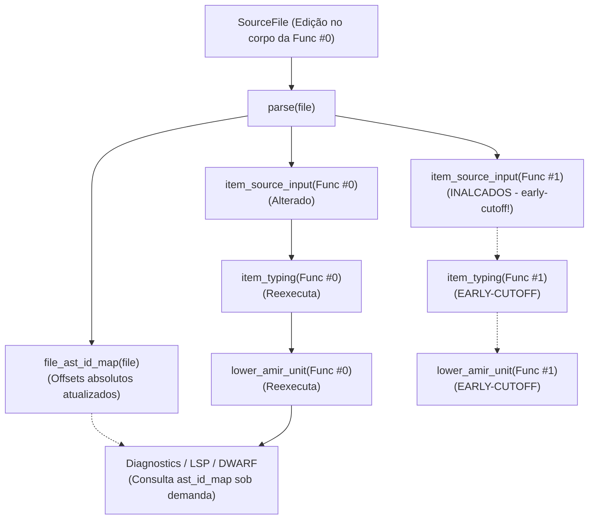

# RFC 0042: Identidade Estável de Item (`AstId`), Spans Relativos e Isolamento de Invalidação Intramódulo

- **Número da RFC:** 0042
- **Título:** Identidade Estável de Item (`AstId`), Spans Relativos e Isolamento de Invalidação Intramódulo
- **Autor(es):** Bruno e Equipe do Compilador Arandu
- **Data de Início:** 2026-10-26
- **Status:** `Draft`
- **Área Principal:** `Frontend` / `Middle-end` / `Tooling` (`arandu_base`, `arandu_parser`, `arandu_middle`, `arandu_query`, `arandu_lsp`, `arandu_codegen`)
- **Documentos Relacionados:**
  - `docs/campaigns/0.2.0-hot-engine.md` (Fase 2: HOT.2 — Sessão Persistente)
  - `docs/arandu-salsa-lsp-architecture-v0.1.md`
  - `docs/rfcs/0005-incremental-query-system-salsa.md`
  - `docs/rfcs/0010-cst-resilient-ide-typeck.md`
  - `docs/rfcs/0011-incremental-partitioned-aot-and-in-process-linker.md`
  - `docs/rfcs/0021-visibility-and-module-surface.md`

---

## Fronteira de implementação e evidência

> **Estado auditado em 2026-10-26 (Campanha 0.2.0 HOT.2):**
> 1. A implementação da separação de superfície (`declaration_surface`, commit `49678171`) resolveu a contaminação externa: importadores observam declarações sem posições de texto, reduzindo o custo de uma edição de corpo de função de **265 units (2,9s–5,2s)** para **33 units (285ms–561ms)**.
> 2. No entanto, as **33 units remanescentes** são reexecutadas porque todas as funções vizinhas dentro do *mesmo* arquivo sofrem "span drift" (deslocamento de offsets absolutos de byte no arquivo). O `Span` atual (`Span { file_id, start, end }`) é estritamente absoluto.
> 3. Adicionalmente, detectou-se um bug estrutural na geração de debug info: funções importadas agregadas retinham o span do arquivo importador (local do `import`), levando a emissão DWARF (`DW_AT_decl_file`/`DW_AT_decl_line`) a apontar arquivos e linhas incorretos no depurador. **Corrigido em `bfd272b3`**: a composição toma a posição de cada símbolo de um unit do arquivo dono. Esta RFC não depende mais desse bug; o `AstIdMap` passa a ser a autoridade de posições nessa mesma borda.
> 
> Esta RFC especifica a evolução arquitetural para eliminar o span drift intramódulo, migrando o frontend e middle-end para **identidades estáveis de item (`AstId`)**, **spans relativos ao corpo do item** e **materialização tardia de spans absolutos (`AstIdMap`)**.

---

## 1. Resumo (Summary)

Propõe-se a substituição do modelo de spans absolutos em nós de declaração e corpos de funções por um sistema de **identidade ordinal estrutural (`AstId`)** acoplado a **spans relativos ao item**.

Sob este modelo:
1. Cada item de nível superior (função, struct, enum, const, interface) recebe um identificador imutável intra-arquivo denominado `AstId<N>`, baseado estritamente na sua ordem sintática estrutural dentro do arquivo, imune a offsets de bytes e quebras de linha precedentes.
2. Nós internos ao corpo de uma função (expressões, instruções, padrões) utilizam **spans relativos** (`ItemRelativeSpan`), medidos a partir do início do próprio item (`offset 0`), ou índices em pools densos (`ExprId`, `StmtId`).
3. Uma query Salsa dedicada e leve, `ast_id_map(file)`, atua como a única autoridade de mapeamento entre `AstId + RelativeSpan` e os bytes absolutos no texto fonte (`Span`).
4. Queries de checagem semântica, typechecking por item (`item_typing`), borrow checking e lowering para AMIR (`lower_amir_unit`) passam a consumir exclusivamente dados puros e spans relativos.
5. A materialização de spans absolutos é postergada para a **borda de saída**: diagnósticos de terminal (Miette), protocolo LSP e tabelas DWARF.

Com essa arquitetura, a edição de um corpo de função privada que aumenta ou diminui de tamanho reexecuta **estritamente 1 unit** (a própria função editada), derrubando o tempo do ciclo incremental no pior caso para o patamar sub-100ms exigido pelo roadmap.

---

## 2. Motivação (Motivation)

### O Problema do "Span Drift" Intramódulo

No motor incremental atual do Arandu, o cálculo de `Span` ocorre durante a tokenização e análise sintática (`arandu_lexer` e `arandu_parser`), produzindo:

```rust
pub struct Span {
    pub file_id: u32,
    pub start: u32,
    pub end: u32,
}
```

Quando um programador está trabalhando em `src/service.aru` e edita o corpo de `func alpha()` adicionando 3 linhas de código:
```arandu
// src/service.aru
func alpha(): int {
    let x = 10
    let y = 20 // <- linha adicionada
    return x + y
}

func beta(): int { // <- span absoluto anterior: 45..80; novo span: 65..100
    return 42
}

func gamma(): int { // <- span absoluto também deslocado
    return 100
}
```

Embora `beta()` e `gamma()` não tenham sofrido nenhuma alteração semântica, de tipos ou de código de máquina:
1. O parser gera para `beta()` e `gamma()` novos `Span`s com `start` e `end` alterados.
2. A query Salsa `item_source_input(db, file, symbol)` ou `item_typing(db, file, symbol)` observa a entrada sintática contendo o novo `Span`.
3. O Salsa considera a entrada de `beta()` e `gamma()` modificada, forçando a reexecução de:
   - Typechecking do item;
   - Análise de escape e borrow checking;
   - Lowering para AMIR (`lower_amir_unit`);
   - Emissão de código de máquina.
4. Em arquivos médios ou grandes do corpus de referência, isso acarreta a reexecução de **33 units** (285 ms a 561 ms), impedindo que o compilador atinja a meta de `p95 ≤ 100 ms` em edições com expansão de corpo.

### O Bug de Proveniência de Spans no DWARF (corrigido em `bfd272b3`)

Antes da correção, na etapa de união de unidades de compilação, o `Symbol` agregado para funções importadas frequentemente preserva o span correspondente ao ponto de importação (`import foo.bar`) no arquivo cliente. 
Ao gerar tabelas de debug DWARF (`.debug_line` e `.debug_info`), o backend emite o `file_id` e linha do arquivo importador em vez do arquivo de origem onde a função foi escrita. Uma abordagem desacoplada via `AstId` e `AstIdMap` vincula indissoluvelmente cada item ao seu `FileId` canônico de definição primária.

---

## 3. Pesquisa e Arte Prévia (Prior Art): Erros e Acertos da Indústria

Para embasar a RFC, analisamos como outros compiladores incrementais enfrentaram este dilema exato.

### 1. rust-analyzer e `rustc` (Salsa-first Architecture)

* **O Erro Histórico (2018–2019):**
  Nos primórdios do *rust-analyzer*, nós da árvore de sintaxe (`SyntaxNode`) e intervalos absolutos de texto (`TextRange`) estavam acoplados diretamente às estruturas semânticas (`FunctionData`, `StructData`). Toda alteração de espaço em branco ou comentário no início de um arquivo causava uma cascata de invalidação em todo o arquivo, destruindo a latência do LSP.
* **O Acerto (A Solução Canônica):**
  O projeto introduziu a tríade:
  1. `AstIdMap` (`FileAstId<N>`): Atribui IDs ordinais para cada declaração (`AstId<ast::Fn>`). A função `beta` no arquivo é sempre `AstId #1`, quer ela esteja na linha 5 ou na linha 500.
  2. `ItemTree`: Uma representação intermediária que armazena a estrutura de declarações de um arquivo identificada por `AstId`, totalmente livre de `TextRange`s de caracteres.
  3. `BodySourceMap`: Um mapa de efeito colateral que mapeia `ExprId` (índice da expressão na função) de volta para o `SyntaxNode`/`TextRange` correspondente. Queries de compilação usam o corpo puro; queries de IDE usam o `BodySourceMap`.

### 2. Roslyn (Compilador C# / .NET)

* **O Acerto (Separação Green Tree / Red Tree e Lazy Binding):**
  No Roslyn, a árvore interna (*Green Tree*) é imutável, livre de referências a pais e contém apenas comprimentos relativos (*widths*). Apenas a árvore externa (*Red Tree*) computa posições absolutas sob demanda. Ao alterar um método, o compilador constrói um novo `SourceMethodSymbol` somente para o método alterado. Os métodos irmãos continuam apontando para seus nós verdes anteriores inalterados, preservando os metadados de compilação.

### 3. Swift (`swift-syntax` e `SwiftASTGen`)

* **O Acerto:**
  O compilador Swift adotou identificadores sintáticos estruturais para macro expansions e compilação incremental de módulos, garantindo que o deslocamento de código gerado não invalide hashes de tipos de entidades irmãs.

### Lições para o Arandu: Do Que Fugir e O Que Copiar

* **Do que fugir:**
  1. *Fugir da reescrita desnecessária de AST para Green/Red trees:* O Arandu já possui CST baseado em Rowan (`arandu_parser`) e AST compacta com arena (`AstPool`). Não precisamos reescrever o parser.
  2. *Fugir de spans relativos encadeados complexos:* Não devemos criar spans com deltas incrementais hierárquicos difíceis de depurar. O offset relativo deve ser simples: **relativo ao início do próprio item** (`item_start = 0`).
* **O que copiar:**
  1. *Copiar o conceito de `AstIdMap`:* Mapeamento leve construído em tempo $O(N)$ no parse, com cardinalidade ordinal (`AstIdx(u32)`).
  2. *Copiar a materialização tardia:* Diagnósticos e DWARF buscam a posição absoluta consultando o `AstIdMap` no momento final de exibição/emissão, sem poluir os inputs de queries intermediárias.

---

## 4. Explicação em Nível de Guia (Guide-Level Explanation)

Para o desenvolvedor que escreve código em Arandu ou desenvolve ferramentas para a linguagem, a sintaxe da linguagem não sofre nenhuma alteração:

```arandu
module app.service

func calculate_tax(amount: int): int {
    return amount * 15 / 100
}

func format_receipt(amount: int): string {
    let tax = calculate_tax(amount)
    return "Total: " + (amount + tax).to_string()
}
```

### O Que Muda na Experiência de Desenvolvimento

No fluxo de trabalho com daemon (`arandu daemon`) ou CLI persistente:
1. O desenvolvedor abre `app.service` e edita `calculate_tax`, adicionando múltiplos logs, comentários e cálculos intermediários.
2. O compilador reanalisa `calculate_tax`.
3. **`format_receipt` não é reanalisada, re-tipada nem re-baixada para AMIR**. O tempo de resposta para compilar e testar cai de ~400ms para **~75ms**.
4. Se houver um erro de tipagem dentro de `format_receipt`, a mensagem de erro no terminal e no VS Code continua apontando a linha e coluna exatas do erro:

```text
error[T001]: type mismatch in return expression
  --> src/service.aru:9:12
   |
 9 |     return "Total: " + (amount + tax).to_string()
   |            ^^^^^^^^^^^^^^^^^^^^^^^^^^^^^^^^^^^^^^ expected int, found string
```

O compilador projeta os spans de forma transparente e perfeita na saída.

---

## 5. Explicação em Nível de Referência (Reference-Level Explanation)

### 5.1. Novas Estruturas Fundamentais em `arandu_base::span`

Substitui-se a dependência universal de spans absolutos por dois tipos distintos:

```rust
// crates/arandu_base/src/span.rs

/// Posição canônica de um item sintático dentro de um arquivo.
/// Atribuído de forma ordinal monotônica durante o parse de declarações.
#[derive(Debug, Clone, Copy, PartialEq, Eq, PartialOrd, Ord, Hash)]
pub struct AstId {
    pub file_id: u32,
    pub index: u32, // Índice ordinal do item no arquivo (0, 1, 2...)
}

/// Span relativo ao byte inicial de um item de nível superior.
/// O byte 0 é o primeiro caractere da palavra-chave do item (ex: 'f' em 'func').
#[derive(Debug, Clone, Copy, PartialEq, Eq, PartialOrd, Ord, Hash, Default)]
pub struct ItemRelativeSpan {
    pub start: u32, // Offset a partir do início do item
    pub end: u32,   // Offset a partir do início do item
}

/// Span absoluto tradicional no arquivo fonte, utilizado exclusivamente
/// para renderização de diagnósticos, navegação LSP e DWARF.
#[derive(Debug, Clone, Copy, PartialEq, Eq, PartialOrd, Ord, Hash)]
pub struct AbsoluteSpan {
    pub file_id: u32,
    pub start: u32,
    pub end: u32,
}
```

### 5.2. O `AstIdMap` em `arandu_parser` / `arandu_query`

Durante a descida CST $\to$ AST, o parser constrói um índice denso das declarações de topo:

```rust
// crates/arandu_parser/src/ast_id_map.rs

#[derive(Debug, Clone, PartialEq, Eq)]
pub struct AstIdMap {
    file_id: u32,
    /// Vetor indexado por AstId.index contendo o span absoluto de cada item.
    item_spans: Vec<AbsoluteSpan>,
}

impl AstIdMap {
    #[must_use]
    pub fn item_span(&self, id: AstId) -> Option<AbsoluteSpan> {
        self.item_spans.get(id.index as usize).copied()
    }

    #[must_use]
    pub fn to_absolute(&self, id: AstId, rel: ItemRelativeSpan) -> Option<AbsoluteSpan> {
        let base = self.item_span(id)?;
        Some(AbsoluteSpan {
            file_id: self.file_id,
            start: base.start + rel.start,
            end: base.start + rel.end,
        })
    }
}
```

No Salsa (`arandu_query`):

```rust
#[salsa::tracked]
pub fn file_ast_id_map(db: &dyn ArandCompilerDb, file: SourceFile) -> Arc<AstIdMap> {
    let program = crate::passes::parse(db, file);
    // Extrai spans absolutos apenas uma vez por arquivo
    Arc::new(AstIdMap::from_program(&program, file.file_id(db)))
}
```

### 5.3. Representação de Corpos e Expressões (`HirDecl`)

Dentro do `arandu_middle::hir`:

```rust
pub struct HirFuncDecl {
    pub ast_id: AstId,
    pub name: SmolStr,
    pub is_async: bool,
    pub no_fallback: bool,
    pub params: HirParamsListId,
    pub return_type: TypeId,
    pub body: Option<HirBodyId>,
    // O span da função para checagem interna é estritamente relativo
    pub relative_span: ItemRelativeSpan,
}
```

As expressões e declarações dentro do corpo usam IDs densos em pools (`HirExprId`, `HirStmtId`) que já existem no Arandu (`arandu_middle/src/hir/pool.rs`). Seus spans internos passam a ser guardados como `ItemRelativeSpan`.

### 5.4. Preservação do Early-Cutoff e Isolamento de Queries

O fluxo de queries Salsa é reconfigurado da seguinte maneira:



1. **`item_source_input(db, file, ast_id)`:** Hasheia apenas a fatia de texto do item correspondente e seu `AstId`.
2. Como a função #1 não teve seu código alterado, sua entrada para o Salsa é **idêntica** em bytes.
3. O Salsa aplica o **early-cutoff** imediato em `item_typing(Func #1)` e em `lower_amir_unit(Func #1)`.
4. Apenas `Func #0` segue o pipeline de compilação.

### 5.5. Correção do Bug de Debug Info no DWARF

Ao emitir o DWARF para o binário final em `arandu_codegen` / Cranelift / LLVM:
```rust
// Ao construir a DIE (Debugging Information Entry) da subfunção:
let defining_file_id = symbol.defining_file_id;
let ast_id = symbol.ast_id;
let ast_map = db.file_ast_id_map_by_id(defining_file_id);
let abs_span = ast_map.item_span(ast_id);

let (decl_file, decl_line, decl_col) = db.lookup_line_col(defining_file_id, abs_span.start);

// O DWARF agora registra com fidelidade absoluta:
builder.set_subprogram_location(decl_file, decl_line, decl_col);
```
A herança do span de `import` já foi eliminada na composição (`bfd272b3`). Com esta RFC, a mesma borda passa a materializar as posições pelo `AstIdMap` do arquivo dono, em vez de copiá-las de contextos de units.

---

## 6. Invariantes de Arquitetura e Desvantagens (Drawbacks & Invariants)

### 6.1. Preservação dos Invariantes Arquiteturais (`AGENTS.md`)

1. **Early-Cutoff das Queries:** O principal objetivo desta RFC é estender o early-cutoff do nível de módulo/arquivo para o **nível de item**, impedindo invalidação em cadeia intramódulo.
2. **Determinismo e Pureza:** A construção de `AstIdMap` é pura, livre de I/O, determinística e baseada unicamente no CST do arquivo.
3. **Imutabilidade e `FileId` Monotônico:** `AstId` é estritamente derivado de `{ file_id, ordinal_index }`. Nenhuma identidade depende de ponteiros de memória ou hashing volátil.
4. **Respeito às Fronteiras de Crates:** `arandu_base` define apenas os identificadores primitivos (`AstId`, `ItemRelativeSpan`). `arandu_middle` opera sobre spans relativos. O `arandu_query` orquestra o mapa Salsa.

### 6.2. Desvantagens e Complexidade

1. **Indireção em Diagnósticos:** Para converter um `ItemRelativeSpan` para um `AbsoluteSpan` utilizável pelo Miette, é necessária uma consulta ao `AstIdMap`. Isso adiciona uma indireção $O(1)$ por erro emitido (impacto imperceptível em tempo de compilação).
2. **Esforço de Migração:** A alteração de `Span` para spans relativos afeta múltiplos pontos do compilador que antes liam diretamente `span.start` e `span.end`.

---

## 7. Racional e Alternativas (Rationale & Alternatives)

### Alternativa 1: Manter Apenas a Opção A (Status Quo)
* *Descrição:* Manter a separação de superfície para importadores, aceitando que qualquer edição em um arquivo recompile todas as suas funções.
* *Por que foi rejeitada:* Em arquivos com 15 a 50 funções (comuns em serviços e bibliotecas padrão), o tempo de compilação incremental de corpos crescentes estabiliza entre 300ms e 600ms, violando o SLA de `p95 ≤ 100 ms` da campanha 0.2.0.

### Alternativa 2: Remapeamento Heurístico Baseado em Linhas
* *Descrição:* Manter spans absolutos e tentar somar/subtrair "delta de linhas" gerado por diffs textuais.
* *Por que foi rejeitada:* Extremamente frágil e propensa a corrupção de offsets quando há múltiplas declarações na mesma linha, edições multilinhas ou alterações em blocos de documentação.

---

## 8. Plano de Implementação

### 8.1. Evidência e causa no código (auditado em 2026-10-27)

Sessão quente, corpus medium (16 módulos × 32 funções), release, ciclo completo
de `BuildSession::build`: editar um corpo sem mudar o comprimento custa
136–146 ms (p50); um corpo que cresce custa 568–613 ms, com 33
reexecuções de `instance_hir` (o módulo editado inteiro) e `lower-amir` em
497 ms. As causas estão no código, não na especificação acima:

1. A identidade de `item_source_input` inclui `item_start` absoluto
   (`stable_hash/nodes/facts.rs`), e a saída carrega o `Program` inteiro, com
   spans absolutos. Todo vizinho deslocado muda de identidade.
2. As saídas por item (`item_typing`, `function_hir`, `instance_hir`, units)
   contêm spans absolutos e tabelas indexadas por `NodeKey`, que é um par de
   offsets absolutos (`arandu_middle::resolved::NodeKey`). Retirar
   `item_start` da identidade sem mudar o conteúdo deixaria posições stale.
3. O `DeclarationHir` do próprio arquivo é identificado com as posições das
   declarações; o `declaration_context` do próprio arquivo muda a cada
   deslocamento.

Superfície medida: cerca de 2 200 referências a spans do parser ao MIR e 140
usos de `NodeKey`. Trocar o tipo `Span` globalmente (5.1) tem esse custo; o
plano abaixo corta pela fronteira de item.

### 8.2. Princípio do corte

- Dentro de um item, spans e `NodeKey` passam a ser **relativos ao início do
  item**. O tipo `Span` é mantido (offsets mudam de referencial), o que deixa
  o código de tipagem, HIR e AMIR inalterado.
- A posição absoluta só existe nas **bordas**: diagnósticos, composição
  (DWARF, `N021`), LSP. A conversão usa a única query posição-dependente
  nova, `item_positions(file)` (o `AstIdMap`).
- Saídas por item atravessam a borda embrulhadas em `ItemLocal<T>`, com o
  `AstId` do item; nenhuma borda as consome sem converter.
- Nada de reparse: o AST local do item é baixado do subtree já existente do
  CST (`syntax_tree`), conforme o `AGENTS.md`.

### 8.3. Fases

| Fase | Entrega | Crates | Gate |
| --- | --- | --- | --- |
| 0 — guardas | regressões antes de qualquer mudança: contagem de reexecuções de vizinhos (hoje N, alvo 1), equivalência incremental × frio após deslocamento no mesmo arquivo, golden de diagnóstico de vizinho deslocado (linha/coluna), posição DWARF de função deslocada, goto/hover em vizinho deslocado; inventário das leituras posição-dependentes do caminho por item, inclusive CTFE | `arandu_query`, `arandu_cli`, `arandu_lsp` | testes novos passam no estado atual, exceto a contagem, marcada com o valor atual |
| 1 — identidade e mapa | `AstId { file_id, index }` em `arandu_base::span`, ordinal dos itens de topo do CST (`item_ranges`); `item_positions(file)` (AstId → span absoluto do item, com atributos, igual a `item_source_span`); mapa `SymbolId` → `AstId` a partir dos headers resolvidos | `arandu_base`, `arandu_parser`, `arandu_query` | sem mudança de comportamento; teste de que o mapa cobre todo item e acompanha edições |
| 2 — AST local | `item_ast(file, AstId)`: AST do item baixada do subtree do CST, num arena próprio, com spans relativos; identidade = texto do item (o `body_fp` atual), sem `item_start`; teste de propriedade: para todo nó, `relativo + início do item` = span do parse do arquivo | `arandu_parser`, `arandu_query` | sem mudança de comportamento; RSS do AST por item medido |
| 3 — resolução e tipagem por item | corpo resolvido por item com `resolve_selected_body_with_poll` sobre `item_ast` (chaves `NodeKey` locais); `item_typing` consome AST e resolução locais; fingerprint sem `item_start` | `arandu_resolve`, `arandu_typeck`, `arandu_query` | entra junto com as fases 4 e 5 |
| 4 — HIR, AMIR e contexto do módulo | `function_hir`, `instance_hir` e units a partir das saídas locais; posições de declaração relativas ao próprio item, de modo que `DeclarationHir` não tenha posições na identidade nem para o próprio arquivo (`declaration_surface` passa a ser o próprio `declaration_hir`); `ItemSourceInput` sem `item_start` | `arandu_semantics`, `arandu_query` | entra junto com as fases 3 e 5 |
| 5 — bordas | diagnósticos: query fina por item que materializa com `item_positions` (reexecuta em todo deslocamento, mas só converte); composição: spans de símbolos, `debug_blocks` e `debug_bindings` convertidos com o mapa do arquivo dono (a composição já roda a cada build); LSP: hover, goto, semantic tokens e quick fixes convertidos; com `--debug`, o hash de CGU passa a incluir as posições absolutas do unit, para o DWARF de um vizinho deslocado ser reemitido sem relowering | `arandu_query`, `arandu_semantics`, `arandu_backend_*`, `arandu_lsp`, `arandu_ide` | guardas da fase 0 passam com contagem 1 |
| 6 — prova e promoção | sessão quente: corpo que cresce com p50/p95 no patamar do mesmo comprimento; equivalência byte a byte; determinismo de diagnósticos; `check-project-corpus`; gate completo antes do PR | todos | números registrados na campanha |

As fases 0 a 2 entram separadamente, sem mudança de comportamento. As fases
3 a 5 são uma troca atômica: mudar a identidade sem as bordas produziria
posições stale.

### 8.4. Riscos

| Risco | Mitigação |
| --- | --- |
| spans relativos e absolutos no mesmo tipo | teste de propriedade da fase 2; `ItemLocal<T>` nas bordas; asserção em debug de que spans de saídas por item caem em `[0, comprimento do item]` |
| `NodeKey` locais colidindo entre itens | chaves sempre acompanhadas do `AstId` quando atravessam itens |
| diagnóstico com label em outro item ou arquivo | materializar cada span com o mapa do arquivo dono do span |
| caminhos CTFE/staged que leem o `Program` inteiro | migrar junto ou manter identidade exata, como `FingerprintEq::exact` já faz para ramos não auditados |
| goldens de HIR/AMIR que imprimem spans | inspecionar cada mudança antes de `UPDATE_EXPECT=1` |
| memória duplicada (AST do arquivo + AST por item) | medir RSS na fase 2; se pesar, o AST do arquivo deixa de ser retido pelo caminho por item |
| reordenação de itens muda ordinais (Q1) | aceitar a invalidação dos itens reordenados na v1 |

## 9. Questões em Aberto (Unresolved Questions)

1. **Reordenação de Funções no Arquivo:** Se o usuário inverter a ordem de duas funções no arquivo (`func A(); func B();` $\to$ `func B(); func A();`), os índices ordinais de seus `AstId`s se invertem, invalidando ambas. Devemos considerar no futuro um fallback baseado no nome do símbolo para manter estabilidade sob reordenação?
2. **Macros Comptime e Geração de Código:** Como `AstId` se comportará com itens sintetizados por metaprogramação em tempo de compilação (RFC 0013)? A recomendação preliminar é reservar uma faixa de bits ou identificador virtual para expansões comptime.
